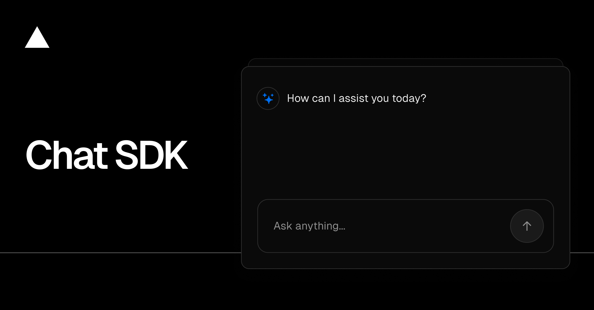

<a href="https://chat.vercel.ai/">
  
  <h1 align="center">Chat SDK</h1>
</a>

<p align="center">
    Chat SDK is a free, open-source template built with Next.js and the AI SDK that helps you quickly build powerful chatbot applications.
</p>

<p align="center">
  <a href="https://chat-sdk.dev"><strong>Read Docs</strong></a> ·
  <a href="#features"><strong>Features</strong></a> ·
  <a href="#model-providers"><strong>Model Providers</strong></a> ·
  <a href="#deploy-your-own"><strong>Deploy Your Own</strong></a> ·
  <a href="#running-locally"><strong>Running locally</strong></a>
</p>
<br/>

## Features

- [Next.js](https://nextjs.org) App Router
  - Advanced routing for seamless navigation and performance
  - React Server Components (RSCs) and Server Actions for server-side rendering and increased performance
- [AI SDK](https://sdk.vercel.ai/docs)
  - Unified API for generating text, structured objects, and tool calls with LLMs
  - Hooks for building dynamic chat and generative user interfaces
  - Supports xAI (default), OpenAI, Fireworks, and other model providers
- [shadcn/ui](https://ui.shadcn.com)
  - Styling with [Tailwind CSS](https://tailwindcss.com)
  - Component primitives from [Radix UI](https://radix-ui.com) for accessibility and flexibility
- Data Persistence
  - [Neon Serverless Postgres](https://vercel.com/marketplace/neon) for saving chat history and user data
  - [Vercel Blob](https://vercel.com/storage/blob) for efficient file storage
- [Auth.js](https://authjs.dev)
  - Simple and secure authentication

## Model Providers

This template ships with [xAI](https://x.ai) `grok-2-1212` as the default chat model. However, with the [AI SDK](https://sdk.vercel.ai/docs), you can switch LLM providers to [OpenAI](https://openai.com), [Anthropic](https://anthropic.com), [Cohere](https://cohere.com/), and [many more](https://sdk.vercel.ai/providers/ai-sdk-providers) with just a few lines of code.

## Deploy Your Own

You can deploy your own version of the Next.js AI Chatbot to Vercel with one click:

[](https://vercel.com/new/clone?repository-url=https%3A%2F%2Fgithub.com%2Fvercel%2Fai-chatbot&env=AUTH_SECRET&envDescription=Generate%20a%20random%20secret%20to%20use%20for%20authentication&envLink=https%3A%2F%2Fgenerate-secret.vercel.app%2F32&project-name=my-awesome-chatbot&repository-name=my-awesome-chatbot&demo-title=AI%20Chatbot&demo-description=An%20Open-Source%20AI%20Chatbot%20Template%20Built%20With%20Next.js%20and%20the%20AI%20SDK%20by%20Vercel&demo-url=https%3A%2F%2Fchat.vercel.ai&products=%5B%7B%22type%22%3A%22integration%22%2C%22protocol%22%3A%22ai%22%2C%22productSlug%22%3A%22grok%22%2C%22integrationSlug%22%3A%22xai%22%7D%2C%7B%22type%22%3A%22integration%22%2C%22protocol%22%3A%22storage%22%2C%22productSlug%22%3A%22neon%22%2C%22integrationSlug%22%3A%22neon%22%7D%2C%7B%22type%22%3A%22blob%22%7D%5D)

## Running locally

Use the environment variables [defined in `.env.example`](.env.example) in an untracked `.env.local` file. This application runs on Node.js and uses PostgreSQL through Drizzle and Postgres.js.

> Note: You should not commit your `.env` file or it will expose secrets that will allow others to control access to your various AI and authentication provider accounts.

1. Use Node.js 22 or newer and the pnpm version pinned in `package.json`.
2. Copy `.env.example` to `.env.local`, set `AUTH_SECRET`, and point `DATABASE_URL` at a development PostgreSQL database. `POSTGRES_URL` is accepted when `DATABASE_URL` is absent.
3. Set `XAI_API_KEY` for live chat. Set `BLOB_READ_WRITE_TOKEN` for hosted uploads and the two Upstash variables if rate limiting is required.

```bash
pnpm install
pnpm db:migrate
pnpm db:verify
pnpm dev
```

Your app template should now be running on [localhost:3000](http://localhost:3000).

## Existing Vercel PostgreSQL database

The `ai` Vercel project already supplies a pooled Neon `DATABASE_URL`. Migration commands prefer `DATABASE_URL_UNPOOLED` or `POSTGRES_URL_NON_POOLING` when available. Runtime connections use the pooled URL, a maximum of five connections per process, a 20-second idle timeout, and a 10-second connection timeout.

The six PostgreSQL migrations in `lib/db/migrations` match the timestamps and checksums already recorded by that database. They create the same schema for a new database and skip previously applied migrations for an existing one. The former SQLite baseline is no longer the active migration history.

The schema preserves UUID identifiers, JSON message parts and attachments, boolean votes, and document versions keyed by `(id, createdAt)`. The document's `kind` property maps to the existing SQL column named `text`. Legacy `Message` and `Vote` tables are retained. The unused SQLite query stub and obsolete conversion scripts have been removed.

`pnpm db:verify` checks column mappings and migration history in a **read-only transaction**, without reading user records. Use it before a release against an existing database. Review any mismatch instead of applying `db:push` to force a match.

`pnpm build` and `pnpm start` do not run migrations. Apply reviewed migrations explicitly with `pnpm db:migrate` from a trusted environment. This adaptation requires no new migration on the already initialized `ai` database. It does not copy data from a separate SQLite/Turso database; keep a backup and plan an explicit import if you have data there.

Vercel still needs `AUTH_SECRET` for sessions and `XAI_API_KEY` for live model calls. A successful build or database check does not establish that those providers are configured. Set secrets in the appropriate Vercel project and environment, then deploy that configuration. Never put database URLs or provider keys in `NEXT_PUBLIC_*` variables or tracked files.

## Local Docker stack

Copy `.env.example` to `.env.local` and set `AUTH_SECRET` first. The template sets `DOCKER_DATABASE_URL` to the PostgreSQL `db` service and keeps the host-side `DATABASE_URL` on `localhost`. Compose gives `DOCKER_DATABASE_URL` precedence, then falls back to `DATABASE_URL` for compatibility with existing external database setups. If neither is set, it uses the bundled database. Set the Docker URL explicitly when using a different PostgreSQL server.

```bash
docker compose --env-file .env.local build app
docker compose --env-file .env.local up -d --wait db
docker compose --env-file .env.local run --rm app npm run db:migrate
docker compose --env-file .env.local run --rm app npm run db:verify
pnpm docker:prod
```

`docker:prod` starts the production build in the local Compose stack. It does not deploy to Vercel. `docker:dev` adds the source mount and starts the Next.js development server with the debugger on localhost port 9229. Both use localhost port 3000 for the app; the database is available on localhost port 5432. The existing PostgreSQL 14 image and named volume are preserved for data compatibility. Migrations remain an explicit step.

## Verification

CI starts a disposable PostgreSQL 17 service, applies and verifies migrations, exercises the database queries, and runs the browser suite with deterministic model, weather, and upload fixtures. Those fixtures test application behavior without making paid provider calls. A separate container job builds the image without database credentials, validates both Compose files, runs migration and schema verification commands against the Compose PostgreSQL service, and checks login/session/protected-API responses.

For the database regression suite, set `TEST_DATABASE_URL` explicitly to a disposable **local** PostgreSQL database, apply migrations to that same database, then run `pnpm test:db`. The suite refuses remote URLs and never falls back to hosted app credentials. It checks JSON/date round trips, account passwords, concurrent votes, versioned documents and suggestions, migration replay, and deletion with legacy foreign keys.

Run `pnpm lint`, `pnpm exec tsc --noEmit`, `pnpm build`, and `pnpm test` for the application checks. Set `PLAYWRIGHT_USE_BUILD=1` to test an existing production build; otherwise Playwright starts the development server. `PORT` controls the local test server and browser URLs.
